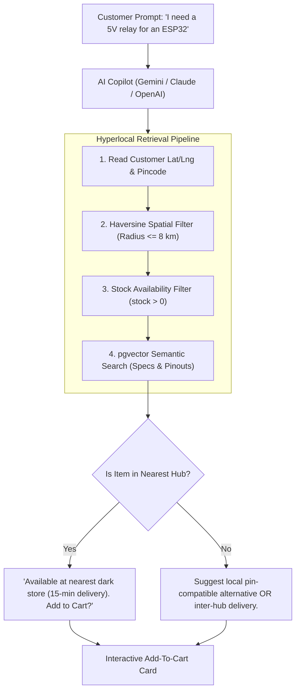

# Spaceborne — Project Memory & Architecture Handoff

> **Machine Transition Reference Document**  
> Prepared for moving work seamlessly to the new machine ("fable computer").

---

## 1. Executive Summary & Core Platform

**Spaceborne** is a mission-critical quick-commerce platform for precision electronics, robotics, and aerospace hardware, paired with an on-demand 3D printing and CNC fabrication service.

### Tech Stack
* **Storefronts (3 Next.js 15 apps)**:
  - `apps/customer-storefront` (Port 3000): Hyperlocal catalog, cart, Razorpay checkout, live order tracking, 3D printing/CNC job requests.
  - `apps/vendor-hub` (Port 3001): Dark store order fulfillment, stock management, 58mm/80mm thermal receipts, fabrication job quotation.
  - `apps/admin-panel` (Port 3002): Master catalog editor, store approvals, Google Maps premises verification, service listing audits.
* **Backend API (`services/api`)**:
  - Node.js (Express 5 + TypeScript) running with strict RBAC (Firebase Auth custom claims verified against PostgreSQL).
  - PostgreSQL with `pgvector` for vector embeddings and semantic search.
* **Cloud Infrastructure (`terraform/`)**:
  - AWS ECS Fargate (API, Worker, Storefront, Vendor Hub, Admin Panel).
  - AWS RDS PostgreSQL & AWS ElastiCache Redis 7.1.
  - Application Load Balancers, CloudFront CDN, S3 KMS encrypted buckets, AWS SES.
* **Active Deployments**:
  - **Live Demo**: [spacebornecomdemo-1.onrender.com](https://spacebornecomdemo-1.onrender.com/) (Service ID `srv-dav9m6c1nsns73arodd0`).
  - **Demo Git**: `https://github.com/GuptaOum/spacebornecomdemo.git`
  - **Prod Git (Personal Public)**: `https://github.com/GuptaOum/Spaceborn-E-commerce.git`
  - **Org Git (Private)**: `https://github.com/Spaceborn-Beyond-Autonomous/Spaceborn-E-commerce.git`

---

## 2. Recent Critical Refinements & Bug Fixes

1. **Streamlined Customer Lifecycle**:
   - Customer-facing order status is strictly mapped to only **3 states**: `Delivered`, `In Transit`, or `Cancelled`.
   - All internal expiration/timeout states now display as `Cancelled`.
2. **"Payment timed out" Completely Eradicated**:
   - All legacy timeout jargon has been eliminated across backend services and frontends.
   - For unpaid/cancelled orders, the payment status displays as `Cancelled (Not Charged)` with a clear customer assurance banner: *"This order is cancelled. No payment was charged."*
3. **Receipt & Invoice Gating**:
   - The "View Receipt" button and GST tax invoice badges now render strictly and exclusively on **`Delivered`** orders. Cancelled orders never show receipts.
4. **Verified Reviews & Ratings**:
   - In the order history, the **"★ Rate Item"** review action only appears on items from **`Delivered`** orders.
   - The backend API (`POST /catalog/products/:productId/reviews`) validates in PostgreSQL that the user has an order containing that product with `status = 'delivered'`.
5. **Telemetry Clean-Up**:
   - Removed the `"Refresh Telemetry"` button completely and renamed internal telemetry labels to standard customer terms (`Delivery Tracking`, `Order History`).
6. **Contact / Help Page Cleaned Up**:
   - Removed the dark *"Instant 15-Min Engineer Callback"* block.

---

## 3. Deep Dive: Hyperlocal Geospatial RAG (Geo-RAG) AI Chatbot

### 3.1 The Core Innovation & Problem Solved
Traditional e-commerce shopping assistants (such as Amazon Rufus) search global product databases using standard keyword or semantic search. If an assistant recommends an actuator or sensor located in a warehouse 1,000 km away, the **15-minute quick-commerce guarantee is broken**.

**Spaceborne's Chatbot solves this via Location-First Retrieval (Geo-RAG)**:



### 3.2 Key Chatbot Sub-Systems

#### A. Hardware Compatibility & Cart Guardrails
The chatbot reads the customer's active cart state and flags missing critical companion hardware:
* Customer adds `Raspberry Pi 5 (8GB)`.
* Agent checks cart: detects absence of a `27W 5V/5A USB-C Power Adapter` or `Micro-HDMI cable`.
* Proactive prompt: *"You've added the Raspberry Pi 5, but don't have a 27W power supply or micro-HDMI cable. Would you like to add the official adapter from the local shelf for 15-min delivery?"*

#### B. Dual-Intent Routing
* **Educational / Theory Queries** (*"What is the difference between SPI and I2C?"*): Routed directly to technical reasoning without cluttering the cart.
* **Transactional Intent** (*"Find me an I2C OLED display under ₹300"*) -> Executes function calling tools:
  1. `searchCatalog(query, maxPrice, filters)`
  2. `checkLocalStoreInventory(productId, userLat, userLng)`
  3. `addToCart(productId, quantity)`
  4. `navigateTo(path)`

#### C. Old plan (superseded)
The notes above this heading were the design sketch. Section 3.3 is what was actually built. Do not add a Gemini or Vercel AI SDK client in the storefront.

### 3.3 What shipped (October 2026, code + Terraform only, not deployed)

Location is taken from the storefront and checked by the API. The model never chooses the customer's coordinates.

* **Storefront** `apps/customer-storefront/src/components/ChatCopilot.tsx`: floating "Ask Spaceborn" drawer. Streams `POST /v1/ai/chat`. Product cards, a Confirm button before anything is added to the cart, and a button (not an automatic redirect) for page links. Conversation is restored from `sessionStorage` only after auth settles, and it is scoped to the signed-in user.
* **Gateway** `services/api` `POST /v1/ai/chat`: optional Firebase auth, Redis rate limit with an in-process fallback, DynamoDB conversation memory with Redis then process-memory fallback, cart names loaded from Postgres, SSE proxy, circuit breaker. If the model is down, the same turn falls back to nearby in-stock search.
* **Copilot** `services/copilot`: FastAPI + LangGraph + `ChatBedrockConverse`. Model is `global.amazon.nova-2-lite-v1:0` until Claude billing is fixed. Tools call the Node catalog over HTTP. The shopper's token is forwarded only to the orders tool. Internal auth is `X-Internal-Token` compared with `hmac.compare_digest`.
* **Kafka**: transactional outbox relay, then an analytics consumer. Idempotency is a `stream_inbox` row keyed by event id (a broker reset must not skip or double-apply). Admin → AI insights reads `ai_demand_signals`, `ai_usage_daily`, and `order_funnel_daily`.
* **Celery**: the API LPUSHes a protocol-v2 message to Redis queue `cad`. `services/cad-worker` measures an uploaded mesh with trimesh and writes `fab_file_analysis`. Vendors see dimensions, volume, watertight, fit, and a suggested price. Customers see dimensions, volume, and fit or gap warnings.
* **Terraform** `terraform/streams_ai.tf` plus the ECS, ECR, and security changes: Cloud Map `spaceborn.internal`, copilot, cad-worker, kafka (KRaft, single broker), analytics consumer, DynamoDB `ai_memory`, and the copilot token in Secrets Manager. Migration `services/api/migrations/012_streams_and_cad.sql` runs with the existing migrate task.
* **Verified on the devbox** (`i-0da4bee10b0448561`, not deployed): API typecheck and 79 tests, copilot 25 tests, CAD worker 9 tests, `terraform validate`, production `next build` of storefront, admin panel, and vendor hub. Live path: STL upload → outbox → Celery → analysis visible on the job, and a live Nova chat through the gateway with a follow-up answered from memory.

### 3.4 Delivery model and the three follow-on features (October 2026, code only, not deployed)

Decision: **the store delivers its own orders**. There is no courier fleet or driver role. "Dispatch" in the Seller Hub means the shop's own rider left with the parcel; the handover code is read to that rider. Copy in both apps says so.

* **Live order tracking** (`services/api/src/orders/tracking.ts`, migration `013_delivery_tracking.sql` adds `rider_lat/rider_lng/rider_at` to `orders`). Vendor `POST /v1/vendor/orders/:id/location {lat,lng}` is accepted only while `out_for_delivery`, from the owning store, at most 30/min per order; it returns remaining km and an ETA (18 km/h, city two-wheeler). Customer `GET /v1/orders/:id/track` is an SSE stream: `snapshot` (status, destination, store position rounded to 3 decimals, rider), then `position` and `status` frames, a 7 s DB poll as backup, 15 s pings, closes on a terminal status or after 30 min. Fan-out is Redis pub/sub (`track:<orderId>`, separate subscriber client in `cache.ts`) with an in-process EventEmitter when Redis is absent. `transitionOrder` publishes a status nudge after commit. UI: `apps/vendor-hub/src/components/RiderShare.tsx` (`watchPosition`, sends every ≥8 s or >25 m, auto-starts after Dispatch, resumes from `sessionStorage`, Google Maps directions link) and `apps/customer-storefront/src/components/LiveDelivery.tsx` (reconnecting stream, Leaflet map over OSM tiles via shared `@spaceborn/web-core/geo-map`).
* **Vendor demand heatmap** `GET /v1/vendor/demand`: `ai_demand_signals` within max(store radius, 8 km), last 30 days, ordered by misses. Seller Hub tab "Demand nearby" (`DemandPanel.tsx`) shows a map of weighted circles plus a table.
* **Instant print quote**: the customer view of a fab job now carries `instantEstimateInr` (sum of the CAD worker's per-file `priceInr`, only before a maker quote); per-file mass/hours stay vendor-only. Storefront shows "Instant estimate: about ₹X … the maker confirms the final price". Vendor `QuoteForm` has a one-tap "Use ₹X · ready in N h" that fills the form; the maker still presses Send.
* Dependencies: `leaflet` + `@types/leaflet` (web-core, both apps); `leaflet/dist/leaflet.css` imported in each app's root layout. `streamEvents` in web-core now wraps `streamServerEvents`, which yields `{event, data}` for named SSE frames.
* Verified on the devbox: API typecheck, 83/83 tests (new `test/tracking.integration.test.ts`: 409/404/400 on bad location posts, owner-only stream with position + ETA, stream closes on delivery, demand scoped to the store), typecheck of web-core/storefront/vendor-hub/admin, production `next build` of storefront and vendor hub.

---

## 4. Distributed Systems & Queue Methodology

### 4.1 Production Asynchronous Queue (Transactional Outbox)
* **Design**: Uses PostgreSQL `outbox` table with `SELECT ... FOR UPDATE SKIP LOCKED` and an autonomous background worker container (`dist/worker.js`) in AWS ECS Fargate.
* **Why not Celery/Redis for payments/orders?** Prevents the **Dual-Write Problem**. In e-commerce, inserting an order in DB and pushing to an external queue can desynchronize if the network drops between writes. With Transactional Outbox, task creation is committed in the **exact same ACID database transaction** as the order.
* **Capabilities**: Handles Razorpay refund reconciliation, SES customer emails, handover OTP dispatch, inventory reservation expiry sweeps, and S3 orphan file cleanups with exponential backoff retries.

### 4.2 Where Celery + Redis Fits In (Compute Tier)
* **AWS ElastiCache Redis 7.1** is already provisioned in private subnets (`terraform/redis.tf`).
* **Best Application for Celery**:
  - **3D CAD Mesh Processing**: Parsing `.step`, `.stp`, `.stl`, `.iges` files uploaded to `fab_jobs`.
  - Python Celery workers using `trimesh`, `numpy`, and `pythonocc` compute volumetric mass, wall thickness, printability, and generate instant automated fabrication quotes.
  - Converts CAD files into lightweight web-viewable `.glb` assets for interactive 3D Three.js browser inspection.

### 4.3 Where Apache Kafka Fits In (Streaming Tier)
* **Shipped use**: the outbox relay publishes order and copilot events. The analytics consumer fills the admin AI-insights tables. One self-hosted KRaft broker on ECS (`apache/kafka:3.9.1`), advertised as `kafka.spaceborn.internal:9092`.
* **Not built**: rover GPS telemetry. Do not add that unless asked.

---

## 5. Quick Commands for the New Machine ("Fable Computer")

```bash
# 1. Clone repository
git clone https://github.com/GuptaOum/Spaceborn-E-commerce.git
cd Spaceborn-E-commerce

# 2. Install dependencies across all npm workspaces
npm install

# 3. Verify types and build
npm run typecheck

# 4. Start local development environment
# Terminal 1: API (port 4000)
npm run dev -w services/api
# Terminal 2: Storefront (port 3000)
npm run dev -w apps/customer-storefront
# Terminal 3: Vendor Hub (port 3001)
npm run dev -w apps/vendor-hub
# Terminal 4: Admin Panel (port 3002)
npm run dev -w apps/admin-panel
```
