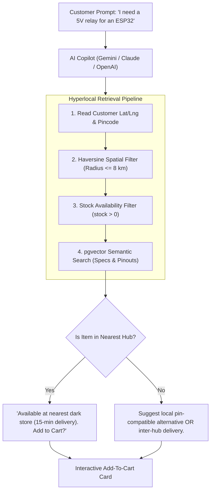

# Spaceborne — Project Memory & Architecture Handoff

> **Machine Transition Reference Document**  
> Prepared for moving work seamlessly to the new machine ("fable computer").

---

## 1. Executive Summary & Core Platform

**Spaceborne** is a mission-critical quick-commerce platform for precision electronics, robotics, and aerospace hardware, paired with an on-demand 3D printing and CNC fabrication service.

### Tech Stack
* **Storefronts (3 Next.js 15 apps)**:
  - `apps/customer-storefront` (Port 3000): Hyperlocal catalog, cart, Razorpay checkout, live order tracking, 3D printing/CNC job requests.
  - `apps/vendor-hub` (Port 3001): Dark store order fulfillment, stock management, 58mm/80mm thermal receipts, fabrication job quotation.
  - `apps/admin-panel` (Port 3002): Master catalog editor, store approvals, Google Maps premises verification, service listing audits.
* **Backend API (`services/api`)**:
  - Node.js (Express 5 + TypeScript) running with strict RBAC (Firebase Auth custom claims verified against PostgreSQL).
  - PostgreSQL with `pgvector` for vector embeddings and semantic search.
* **Cloud Infrastructure (`terraform/`)**:
  - AWS ECS Fargate (API, Worker, Storefront, Vendor Hub, Admin Panel).
  - AWS RDS PostgreSQL & AWS ElastiCache Redis 7.1.
  - Application Load Balancers, CloudFront CDN, S3 KMS encrypted buckets, AWS SES.
* **Active Deployments**:
  - **Live Demo**: [spacebornecomdemo-1.onrender.com](https://spacebornecomdemo-1.onrender.com/) (Service ID `srv-dav9m6c1nsns73arodd0`).
  - **Demo Git**: `https://github.com/GuptaOum/spacebornecomdemo.git`
  - **Prod Git (Personal Public)**: `https://github.com/GuptaOum/Spaceborn-E-commerce.git`
  - **Org Git (Private)**: `https://github.com/Spaceborn-Beyond-Autonomous/Spaceborn-E-commerce.git`

---

## 2. Recent Critical Refinements & Bug Fixes

1. **Streamlined Customer Lifecycle**:
   - Customer-facing order status is strictly mapped to only **3 states**: `Delivered`, `In Transit`, or `Cancelled`.
   - All internal expiration/timeout states now display as `Cancelled`.
2. **"Payment timed out" Completely Eradicated**:
   - All legacy timeout jargon has been eliminated across backend services and frontends.
   - For unpaid/cancelled orders, the payment status displays as `Cancelled (Not Charged)` with a clear customer assurance banner: *"This order is cancelled. No payment was charged."*
3. **Receipt & Invoice Gating**:
   - The "View Receipt" button and GST tax invoice badges now render strictly and exclusively on **`Delivered`** orders. Cancelled orders never show receipts.
4. **Verified Reviews & Ratings**:
   - In the order history, the **"★ Rate Item"** review action only appears on items from **`Delivered`** orders.
   - The backend API (`POST /catalog/products/:productId/reviews`) validates in PostgreSQL that the user has an order containing that product with `status = 'delivered'`.
5. **Telemetry Clean-Up**:
   - Removed the `"Refresh Telemetry"` button completely and renamed internal telemetry labels to standard customer terms (`Delivery Tracking`, `Order History`).
6. **Contact / Help Page Cleaned Up**:
   - Removed the dark *"Instant 15-Min Engineer Callback"* block.

---

## 3. Deep Dive: Hyperlocal Geospatial RAG (Geo-RAG) AI Chatbot

### 3.1 The Core Innovation & Problem Solved
Traditional e-commerce shopping assistants (such as Amazon Rufus) search global product databases using standard keyword or semantic search. If an assistant recommends an actuator or sensor located in a warehouse 1,000 km away, the **15-minute quick-commerce guarantee is broken**.

**Spaceborne's Chatbot solves this via Location-First Retrieval (Geo-RAG)**:



### 3.2 Key Chatbot Sub-Systems

#### A. Hardware Compatibility & Cart Guardrails
The chatbot reads the customer's active cart state and flags missing critical companion hardware:
* Customer adds `Raspberry Pi 5 (8GB)`.
* Agent checks cart: detects absence of a `27W 5V/5A USB-C Power Adapter` or `Micro-HDMI cable`.
* Proactive prompt: *"You've added the Raspberry Pi 5, but don't have a 27W power supply or micro-HDMI cable. Would you like to add the official adapter from the local shelf for 15-min delivery?"*

#### B. Dual-Intent Routing
* **Educational / Theory Queries** (*"What is the difference between SPI and I2C?"*): Routed directly to technical reasoning without cluttering the cart.
* **Transactional Intent** (*"Find me an I2C OLED display under ₹300"*) -> Executes function calling tools:
  1. `searchCatalog(query, maxPrice, filters)`
  2. `checkLocalStoreInventory(productId, userLat, userLng)`
  3. `addToCart(productId, quantity)`
  4. `navigateTo(path)`

#### C. Implementation Plan for Next Machine
1. **Frontend**: Floating drawer component in `apps/customer-storefront` using `@google/genai` or Vercel AI SDK (`useChat`), rendering streaming markdown and clickable product tiles.
2. **Backend**: Endpoint `POST /v1/ai/chat` in `services/api` equipped with Gemini function calling wired to `catalog/search.ts` and PostGIS store queries.

---

## 4. Distributed Systems & Queue Methodology

### 4.1 Production Asynchronous Queue (Transactional Outbox)
* **Design**: Uses PostgreSQL `outbox` table with `SELECT ... FOR UPDATE SKIP LOCKED` and an autonomous background worker container (`dist/worker.js`) in AWS ECS Fargate.
* **Why not Celery/Redis for payments/orders?** Prevents the **Dual-Write Problem**. In e-commerce, inserting an order in DB and pushing to an external queue can desynchronize if the network drops between writes. With Transactional Outbox, task creation is committed in the **exact same ACID database transaction** as the order.
* **Capabilities**: Handles Razorpay refund reconciliation, SES customer emails, handover OTP dispatch, inventory reservation expiry sweeps, and S3 orphan file cleanups with exponential backoff retries.

### 4.2 Where Celery + Redis Fits In (Compute Tier)
* **AWS ElastiCache Redis 7.1** is already provisioned in private subnets (`terraform/redis.tf`).
* **Best Application for Celery**:
  - **3D CAD Mesh Processing**: Parsing `.step`, `.stp`, `.stl`, `.iges` files uploaded to `fab_jobs`.
  - Python Celery workers using `trimesh`, `numpy`, and `pythonocc` compute volumetric mass, wall thickness, printability, and generate instant automated fabrication quotes.
  - Converts CAD files into lightweight web-viewable `.glb` assets for interactive 3D Three.js browser inspection.

### 4.3 Where Apache Kafka Fits In (Streaming Tier)
* **Real-Time Telemetry**: Streaming GPS, battery, and speed data from autonomous delivery rovers and couriers.
* **Event Sourcing & Decoupling**: Replayable distributed commit log for downstream analytics, fraud monitoring, and audit consumers without putting read load on primary databases.

---

## 5. Quick Commands for the New Machine ("Fable Computer")

```bash
# 1. Clone repository
git clone https://github.com/GuptaOum/Spaceborn-E-commerce.git
cd Spaceborn-E-commerce

# 2. Install dependencies across all npm workspaces
npm install

# 3. Verify types and build
npm run typecheck

# 4. Start local development environment
# Terminal 1: API (port 4000)
npm run dev -w services/api
# Terminal 2: Storefront (port 3000)
npm run dev -w apps/customer-storefront
# Terminal 3: Vendor Hub (port 3001)
npm run dev -w apps/vendor-hub
# Terminal 4: Admin Panel (port 3002)
npm run dev -w apps/admin-panel
```
